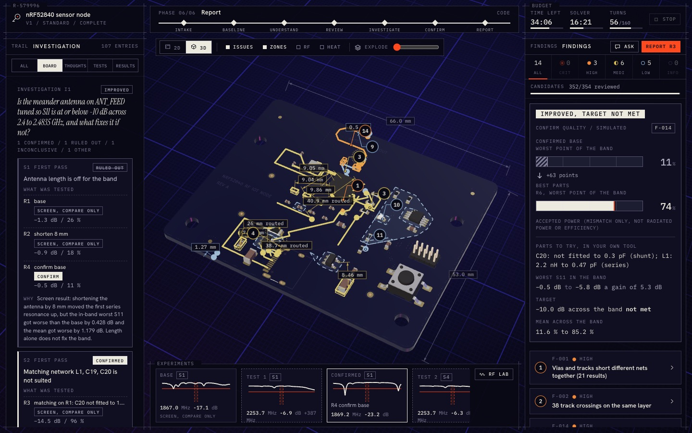
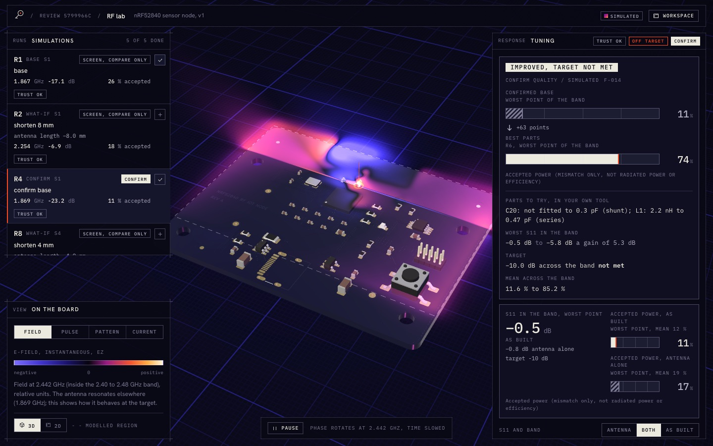
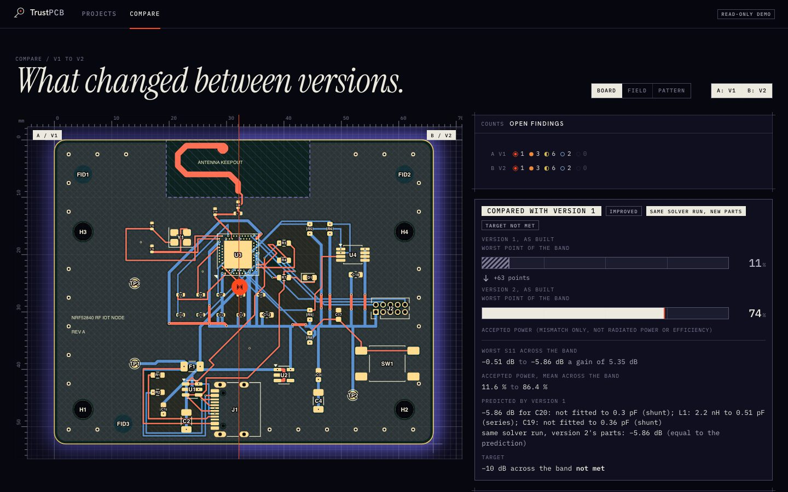

# TrustPCB

**Others read your datasheets. TrustPCB tests your board.**

TrustPCB is an open-source inspection layer for circuit boards. You upload a KiCad project and say what the board must do. An AI agent, Meta's Muse Spark, then studies the board like a senior engineer: it looks at it, forms ideas about what could go wrong, runs real checks and electromagnetic simulations to test those ideas, and writes a report in which every claim is tied to a place on the board and to the evidence behind it.

Upload a new version later and TrustPCB rechecks it and shows what changed.



*A finished review of the bundled nRF52840 sample board (`samples/nrf52840-node/`), in the review workspace: the board in 3D with findings marked on it, the investigation trail, and the confirmed antenna result with its target not met. The solver numbers are real openEMS output and are labelled Simulated; this is a sample board, not a customer design.*

## The inspector rule

**TrustPCB never edits a design.** It reads your files, never changes them, and never produces modified KiCad or manufacturing files. Recommendations are written as steps for you to apply in your own tool. Your upload is copied before anything touches it, and the checks run on the copy.

## What it checks

Plain code does the measuring first, with no AI involved. Then the agent investigates.

**Baseline (KiCad):** design rule check (DRC) and electrical rule check (ERC) through `kicad-cli`, board statistics, layer images and a 3D board view.

**Layout analyzers** (they measure; they never judge):

| Analyzer | What it looks for |
|---|---|
| Function zones | Parts grouped by role (power, radio, digital and so on), with overlapping zones flagged |
| Noise proximity | Switching or RF parts close to sensitive parts |
| Track jitter, detours, sharp corners | Shaky routing, long detours against the straight line, corners sharper than 90 degrees |
| Border tracks | Copper close to the board edge, or running along it |
| Decoupling | Capacitor distance from the IC power pin it serves, and vias on the way |
| Antenna keep-out | Copper, parts and tracks inside an antenna clearance zone |
| RF path | Length, width changes, layer jumps and stubs along RF nets |
| Via count | Layer jumps along important connections |
| Return path | Fast signals that cross a gap in the ground copper beneath them |
| Track impedance | Closed-form estimate of track impedance from width, layer and stackup |

**RF lab (printed antennas):** TrustPCB cuts the antenna region out of your board and simulates it with [openEMS](https://www.openems.de/) in a Docker container. You get an S11 tuning graph, a Smith chart, a 3D radiation pattern, an animated field and a surface-current view, all drawn from real solver output. It can also test what-if changes to the antenna model and calculate matching parts. Nothing is drawn that the solver did not produce.



*The RF lab for version 1 of the sample board: the solver runs, the electric field over the board at 2.442 GHz (time slowed so it is visible), and the confirmed as-built result. Everything on this page is a simulation of a model of the board, not a lab measurement.*

## What each kind of board gets

| Board | What TrustPCB does |
|---|---|
| Printed antenna (a trace or patch drawn in copper) | Everything below, and the antenna is **simulated** in openEMS: S11, match, pattern, field, and what-if changes and matching parts |
| Chip antenna or radio module | A **keep-clear review** only: the antenna keep-out analyzer checks for copper, parts and tracks inside its clearance zone, and the other layout analyzers still run. The antenna is not simulated, and RF is reported as **Not tested** with that reason |
| No radio | **Rule and layout review**: KiCad DRC and ERC, the layout analyzers, and the agent's judgement of what they found. No simulation |

**How long it takes.** A Standard review of a new board takes about 26 to 40 minutes. When the simulations can be reused (a later version with the same antenna copper, or a board already simulated) it takes under 10 minutes. Quick reviews do no simulation and are shorter; Deep reviews can run up to three investigations and take longer.

## How the agent investigates, with physics as the judge

The agent is Muse (`muse-spark-1.3`) running a tool loop over Meta's Messages API. It can only use the TrustPCB tools. It cannot read files, run commands or browse.

1. **Understand.** It reads the goal, the parts and nets, any datasheets you uploaded, and looks at rendered images of the board.
2. **Review.** It works through every analyzer rule group, recording a finding or dismissing the group with a specific reason, and takes close-up views of the board. The server will not let it leave this phase until every group is accounted for.
3. **Investigate.** It ranks suspects, then tests one at a time with simulations: a base run, then what-if changes (for example clearing copper near the antenna, or changing its length). A suspect ruled out stays ruled out.
4. **Confirm.** The best result is re-run at higher quality. Quick screening runs are used only to compare a change with the base run.
5. **Report.** It writes a summary and ranked actions.

Muse is not trusted to produce numbers:

- Tools produce numbers; Muse produces judgment. Every number with a unit in a finding is checked by the server against tool evidence. Anything it cannot match is rejected.
- Every simulation passes automatic trust checks (energy decay, passivity, mesh density, port setup). A result that fails them cannot support a finding.
- An antenna is judged by its S11 across the band as built, not by its deepest dip.
- Budgets are enforced by the server (time, tool calls, images, solver time, tokens). Repeat requests return the stored result, and ideas that stop making progress are closed. A review always ends with a report, even if the agent fails.

## Honest labels

Everything TrustPCB shows carries one of four labels:

| Label | Meaning |
|---|---|
| **Measured** | A tool measured it on your board geometry (for example a distance, a count, a KiCad check result). Only KiCad and the layout analyzers measure. |
| **Simulated** | An openEMS run produced it, and it passed the trust checks. A simulated number is never called measured. |
| **Engineering opinion** | Muse's judgment without a measurement behind it. Opinion cannot be rated critical. |
| **Not tested** | It was not checked, and the reason is stated (for example Docker was missing, or the antenna type is not supported). |

Assumptions, such as a default board stackup, are listed in the report rather than hidden.

**Rechecks and predictions.** When you upload a new version that changes only matching parts, the antenna copper is the same, so version 2's number is the same solver run recalculated with version 2's parts. It is not an independent result. TrustPCB says so: the badge reads "Same solver run, new parts" and the text "Consistent with the prediction: same solver run, recalculated with version 2's parts". "Prediction held" appears only when the geometry changed and a separate confirm run was done.



*Version 1 against version 2 of the sample board. Only the matching parts differ, so the version 2 figure comes from the same solver run and is shown as consistent with the earlier prediction, not as an independent confirmation. The target is still not met, and it says so.*

## Architecture

```text
Next.js UI  (2D board, 3D scene, RF charts, investigation trail, report)
      |   HTTP commands + SSE events
FastAPI app  (one local Python process, SQLite, no queue service)
  |- Intake        unpack, validate, version the upload
  |- Pipeline      kicad-cli + layout analyzers (plain code, no AI)
  |- Review        phases, budgets, stop rules, finding and number checks
  |- Runner        one per review, bound to a profile
  |     |- muse_api   Muse Spark 1.3 over the Messages API (real reviews)
  |     |- scripted   deterministic, calls no model (tests and demos)
  |     '- TrustPCB tools (the only tools the agent has)
  |- Simulation queue ---> Docker container: openEMS (worker/run_scenario.py)
  '- SQLite + artifact folder (.trustpcb/)
```

The web app runs on port 3118 and the backend on port 8118, both bound to `127.0.0.1`.

## Requirements

- Node.js 22 or newer
- [uv](https://docs.astral.sh/uv/) and Python 3.12 (uv installs the Python it needs)
- [KiCad](https://www.kicad.org/) 10, for `kicad-cli`. The sample boards and the tests are saved and run with KiCad 10 (file format `generator_version 10.0`). The version check also accepts KiCad 9, but that is not tested here, and KiCad 9 cannot open the newer sample files. `kicad-cli` is found automatically in the standard install locations, or set `KICAD_CLI_PATH`.
- Docker, only for RF simulation. Without it every other feature works and RF shows as **Not tested**.
- A Muse API key, optional and only for real agent reviews (see below). Without one the scripted runner works, so you can run the app and every test with no key.
- PDF export of reports prints through Playwright. It uses Chrome, Chromium, Edge or Brave if you have one (set `TRUSTPCB_BROWSER` to choose), otherwise the small Chromium that `npm run setup` installs. The HTML report needs nothing extra.

## Quick start

```sh
git clone <this repository> trustpcb
cd trustpcb

# 1. Install backend and web dependencies
npm run setup

# 2. Build the openEMS solver image (needed for RF simulation; takes a while)
docker build -f docker/ems/Dockerfile -t trustpcb-ems:dev .

# 3. Configure (optional: every setting has a default)
cp .env.example .env     # then edit .env

# 4. Start the backend (8118) and the web app (3118)
npm run dev
```

Open http://127.0.0.1:3118 (the launcher opens it for you; set `TRUSTPCB_NO_OPEN=1` to stop that). `npm run dev` generates a fresh random token on every launch and shares it with both services; it refuses to start if port 8118 or 3118 is taken, and Ctrl+C stops both services.

On a fresh clone there is no model runner, so the app uses the **scripted** runner (see "Connecting Muse"). The scripted runner calls no model: the interface, upload, KiCad checks and layout analyzers all work, but the review itself is a fixed script and finds nothing on your board. Set `TRUSTPCB_RUNNER=muse_api` and a key for real reviews. To add your own runner module, set `TRUSTPCB_RUNNER_MODULE` (and, if it needs extra Python packages, `TRUSTPCB_EXTRA_REQUIREMENTS` pointing at a requirements file). See `.env.example`.

To check a production build of the web app: `npm run build`, then `npm --prefix web run start`.

The image name defaults to `trustpcb-ems:dev`; override it with `TRUSTPCB_EMS_IMAGE`. The solver code in `worker/` is mounted into the container at run time, so changing it needs no rebuild.

To check KiCad discovery on its own: `node scripts/check-kicad.mjs`.

### Connecting Muse

1. Put your key in `.env`:

   ```sh
   MODEL_API_KEY=your-key-here
   TRUSTPCB_RUNNER=muse_api
   ```

   `.env` is git-ignored. The key is read only from the environment and is the only credential the Muse runner sends. The runner uses standard Muse models only and refuses any `-contributor` model, because those may use content for training.

2. Check the connection before a real review:

   ```sh
   uv run --project server python scripts/muse-smoke.py
   ```

   It makes a handful of short requests: one tool call, and one tool that returns a small image. If it reports that the model cannot see images returned from tools, run it with `--mode user_message` and set `TRUSTPCB_MUSE_IMAGE_MODE=user_message`.

When `TRUSTPCB_RUNNER` is not set (a fresh clone), or is set to `scripted`, the app uses the scripted runner. It follows a fixed script and calls no model, so it is useful for trying the interface and for tests, but it does not review your board.

Each review is bound to one runner profile, shown in the UI and stored with the review. There is no automatic fallback from one runner to another. Token spend is recorded per review.

### Read-only demo

To show finished reviews without letting anyone upload or start a review, serve a finished data directory read-only:

```sh
scripts/seed-demo.sh <finished-data-dir>            # copies it to .trustpcb-demo/ (a second argument chooses the target)
TRUSTPCB_DEMO_READONLY=1 TRUSTPCB_DATA_DIR=.trustpcb-demo npm run dev
```

With `TRUSTPCB_DEMO_READONLY=1` the backend refuses every `POST`, `PATCH`, `PUT` and `DELETE` with `403` and a clear message, and the web app hides upload, start, dismiss and chat and shows a "Read-only demo" notice. Set `TRUSTPCB_REPO_URL` to put a link to the repository in that notice. `seed-demo.sh` refuses a data directory with a review still running or with a review that did not run on Muse (`--allow-any-runner` accepts that for a private demo), and never changes its source. The copy includes the boards that were uploaded to it, so only seed from a data directory you may share. The demo is still a local app (loopback only); this is not hosted-use hardening.

### Sample boards

| Folder | What it is |
|---|---|
| `samples/nrf52840-node/` | An nRF52840 Bluetooth node (KiCad project with schematic) with an antenna keep-out; the integration tests run it through the RF lab |
| `samples/nrf52840-node-v2/` | The same board after hand edits to three matching parts (L1, C19, C20), with copper unchanged. Upload it as version 2 of the first board to try a recheck |
| `samples/patch-2g5/` | A 2.5 GHz patch antenna on FR-4 (`geometry.json` holds the design values it was generated from) |

Zip a sample folder (or drag the folder in) on the upload screen.

## Tests

```sh
bash scripts/test-related.sh server/trustpcb/pcb/model.py   # tests for the area that owns a path (pytest -n 2)
bash scripts/test-all.sh                                    # everything except tests marked slow (pytest -n 4)
bash scripts/test-all.sh --slow                             # include solver benchmarks and full pipelines
npm run typecheck                                           # web type check
npm --prefix web test                                       # web unit tests
npm run test:release                                        # release script tests
npm run check:versions                                      # every version field agrees
```

No test calls a live model. The slow tests use Docker and the solver image.

## Limits

- **Printed antennas only.** Chip antennas, modules, and antennas on metal or inside a case are not simulated. They get a keep-clear review, and RF is reported as **Not tested** with the reason.
- **Simulated, not measured.** Simulation results are predictions from a model of your board. They are not lab measurements. Treat an antenna as unverified until it is measured on a real board. Run-to-run S11 depth varies by about 0.5 dB because threading changes where the solver stops.
- **Default stackup assumptions.** If the board file has no stackup, TrustPCB assumes FR-4 (permittivity 4.5, loss tangent 0.02, 35 um copper) and lists that as an assumption. Confirm the real stackup on the goal form for results you intend to rely on.
- **KiCad boards only.** Other formats are not imported.
- **Local use only. Do not expose it to the internet.** The backend binds to loopback, requires a per-launch token and checks the `Host` and `Origin` headers, but it has no accounts and no hosted-use hardening. Run it on your own machine, with your own boards.
- **Your board data goes to Meta.** In a Muse review, rendered board images, part and net data and text from your files are sent to the Muse API. Do not upload a board you are not allowed to share.
- **Network use at build time.** The web app loads its one font, Inter, through `next/font/google`, which downloads it when the web app builds or starts.
- **Upload size.** A zip is refused above 100 MB, a project above 500 MB unpacked or 5000 files, and a whole upload above `TRUSTPCB_MAX_UPLOAD_MB` (default 512).

## When something is missing

| Missing | What happens |
|---|---|
| `kicad-cli` | The backend starts and logs a warning. Upload still works and says that KiCad checks, statistics and the 3D model were skipped. `/api/bootstrap` reports the reason. |
| Docker or the solver image | RF reports **Not tested** with that reason. Everything else works. |
| Muse key | With `TRUSTPCB_RUNNER=muse_api` and no `MODEL_API_KEY`, the review stops at its first model call with a message that the key is not set. The scripted runner needs no key. |
| A second review while one runs | Refused with a visible message (HTTP 409); the upload screen links to the running review. |
| A zip with no board, or a file that is not a KiCad board | Refused with the reason (HTTP 422). A board file over 150 MB, or one that takes over 240 s to read, is refused too. |
| The app restarts mid-review | The review is marked **interrupted** (not complete) and says so. Any solver container left running is killed at the next start. |

## Configuration

All settings are optional environment variables; see `.env.example` for the full list. The common ones:

| Variable | Purpose |
|---|---|
| `MODEL_API_KEY` | Muse key for real reviews |
| `TRUSTPCB_RUNNER` | `muse_api` or `scripted` |
| `TRUSTPCB_MUSE_EFFORT` | `low`, `medium` (default), `high` or `xhigh` |
| `TRUSTPCB_DATA_DIR` | Where projects, uploads and the database live (default `.trustpcb/`) |
| `KICAD_CLI_PATH` | Path to `kicad-cli` if it is not found automatically |
| `TRUSTPCB_EMS_IMAGE` | Solver image name (default `trustpcb-ems:dev`) |
| `TRUSTPCB_DEMO_READONLY` | `1` refuses every change and hides upload and start (read-only demo) |
| `TRUSTPCB_REPO_URL` | Repository link shown in the read-only demo notice |
| `TRUSTPCB_MAX_PCB_MB` | Largest board file read, in MB (default 150) |
| `TRUSTPCB_PARSE_TIMEOUT_S` | Longest time spent reading a board file (default 240) |
| `TRUSTPCB_MAX_UPLOAD_MB` | Largest whole upload in MiB (default 512). A zip is capped at 100 MB whatever this is set to |
| `TRUSTPCB_LAB` | `baseline` gives new reviews no RF lab, as if Docker were missing (for trying the interface) |
| `TRUSTPCB_SCRIPT` | Path to a JSON script file for the scripted runner (tests and demos) |
| `TRUSTPCB_BACKEND_PORT` | Port the backend allows in its `Host` check (default 8118). The launcher always starts the backend on 8118, so change this only when you start the backend yourself and point the web app at it with `TRUSTPCB_BACKEND_URL` |
| `TRUSTPCB_RUNNER_MODULE`, `TRUSTPCB_EXTRA_REQUIREMENTS` | Add your own runner (a dotted Python module) and the requirements file it needs. See `.env.example` |
| `TRUSTPCB_EMS_USER` | User id for the solver container (default: your own, so the job folder stays yours; empty leaves the image's user) |
| `TRUSTPCB_DOCKER_PASS_ENV` | Extra environment variable names the Docker client may see (the client otherwise gets a minimal environment) |
| `TRUSTPCB_BROWSER`, `TRUSTPCB_PDF_CONCURRENCY` | Browser used to print PDFs; how many PDF exports run at once (default 1) |

## Repository layout

```text
server/trustpcb/   backend: api, storage, sessions, intake/, pcb/, analyzers/, rf/, review/, prompts/, runners/
worker/            run_scenario.py, runs inside the solver container with no app imports
docker/ems/        pinned openEMS image build
web/               Next.js app (2D board, 3D scene, RF lab, report)
samples/           demo boards
scripts/           launcher, setup, KiCad check, Muse smoke test, demo seeding, test runners, release script
docs/              architecture, release guide, README images (docs/images/) and the hackathon disclosure
.github/           CI and release workflows, issue and pull request templates, Dependabot
```

How the pieces fit together, where to add an analyzer and the limits are in [docs/ARCHITECTURE.md](docs/ARCHITECTURE.md). The hackathon disclosure is in `docs/HACKATHON.md`.

## Contributing

Contributions are welcome. Read [CONTRIBUTING.md](CONTRIBUTING.md) for setup, how to run the tests, commit and pull request style, what makes a good analyzer or finding, and the project rules: TrustPCB never edits a design, findings trace to evidence, and simulated results are labelled Simulated. Everyone taking part follows the [Code of Conduct](CODE_OF_CONDUCT.md). Report security problems privately, as described in [SECURITY.md](SECURITY.md).

## CI and releases

Every pull request runs one fast workflow (`.github/workflows/ci.yml`): backend tests without the slow and Docker tests, the web type check and tests, and a check that every version field agrees. It calls no model, runs no solver and needs no secrets. Tests that need `kicad-cli` skip themselves where KiCad is not installed, which is the case in CI. A docs-only change skips the heavy jobs.

Merging a pull request to `main` creates a release automatically: label `major` bumps the first number, label `minor` the middle one, and anything else the last one (X.Y.Z). The version fields and [CHANGELOG.md](CHANGELOG.md) are updated, the commit is tagged and a GitHub Release is published. See [docs/RELEASING.md](docs/RELEASING.md), which also lists what a maintainer sets up once the repository exists.

## Licensing

TrustPCB is released under the [MIT License](LICENSE).

KiCad (`kicad-cli`, GPL-3.0-or-later) and openEMS (GPL-3.0) are run only as separate programs. TrustPCB does not import, link to or redistribute them, and their licences do not apply to TrustPCB's own code. If you build or distribute the openEMS Docker image, you are responsible for meeting the GPL terms for that image.

The sample boards embed KiCad library footprints, symbols and 3D models under CC BY-SA 4.0 with the KiCad libraries exception (see [samples/README.md](samples/README.md)). All other licences are listed in [NOTICE](NOTICE). The backend and web shell started from the author's earlier MIT project, earlier project.
