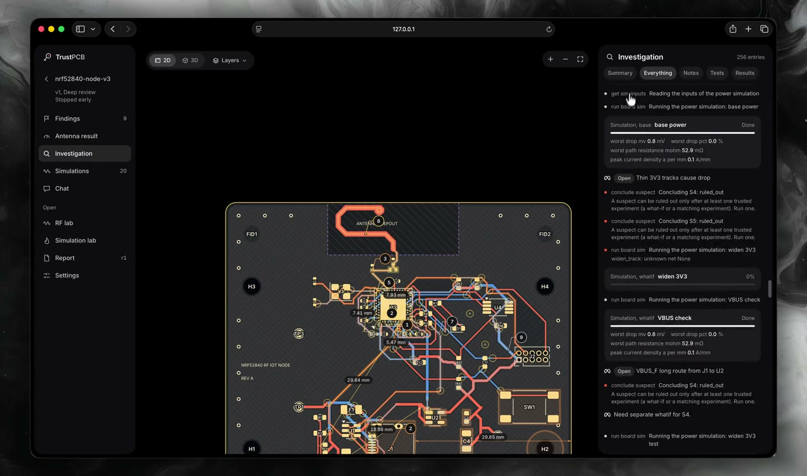

<div align="center">


# TrustPCB

**Catch board problems before you pay to build them.**

An open-source AI reviewer for KiCad boards that runs real checks and simulations and shows the evidence for every claim.

[Website](https://trustpcb.planary.xyz) · [Releases](https://github.com/ilovetensor/trustpcb/releases) · [Changelog](CHANGELOG.md) · [Contributing](CONTRIBUTING.md)

[](https://github.com/ilovetensor/trustpcb/actions/workflows/ci.yml)
[](https://github.com/ilovetensor/trustpcb/releases)
[](LICENSE)
[](https://x.com/r0vrrr)

 &nbsp;Built on **Meta Muse Spark**. The demo below runs on Muse Spark Open.

[](docs/media/demo.mp4)

*Demo (1 min 42 s): a full review of `samples/nrf52840-node-v3` running on `meta-models/muse-spark-open-1026` via Baseten.*

</div>

## What it is

You upload a KiCad project and say what the board has to do. TrustPCB then:

1. **Measures.** Plain code runs first, with no AI: KiCad's design and electrical rule checks, plus layout analyzers covering decoupling, return paths, the antenna keep-out, RF paths, pair skew, track impedance and more.
2. **Investigates.** Muse studies the board like a senior engineer. It looks at rendered images, ranks suspects, and tests them one at a time with simulations (openEMS for printed antennas, plus power, heat and signal). Suspects are confirmed or ruled out with evidence.
3. **Reports.** You get findings pinned to places on the board, each tied to the tool output behind it, and ranked actions to apply in your own tool.

Upload a new version later and TrustPCB rechecks it and shows what changed.

**TrustPCB never edits a design.** It reads a copy of your files and never writes KiCad or manufacturing files.

## Honest labels

Every result carries one of four labels:

| Label | Meaning |
|---|---|
| **Measured** | KiCad or a layout analyzer measured it on your board geometry |
| **Simulated** | A solver run produced it and passed the trust checks (energy decay, passivity, mesh density, port setup) |
| **Engineering opinion** | Muse's judgment with no measurement behind it. It can never be rated critical |
| **Not tested** | It wasn't checked, and the reason is given |

Muse provides judgment, and tools provide the numbers. The server checks every number with a unit in a finding against tool evidence and rejects any it can't match. If a what-if can't be built on the board, for example lengthening an antenna into the board edge, it fails its trust check and no curve is drawn. Assumptions such as a default stackup are listed in the report.

## Quick start

You need Node.js 22+ and git. [KiCad](https://www.kicad.org/) 10 adds the rule checks, and Docker adds RF simulation. The installer adds [uv](https://docs.astral.sh/uv/) if you don't have it.

**macOS / Linux**

```sh
curl -fsSL https://raw.githubusercontent.com/ilovetensor/trustpcb/main/install.sh | sh
```

**Windows (PowerShell)**

```powershell
irm https://raw.githubusercontent.com/ilovetensor/trustpcb/main/install.ps1 | iex
```

The installer clones the repo into `~/trustpcb` (set `TRUSTPCB_DIR` to choose another folder) and installs the dependencies. Then start TrustPCB:

```sh
cd ~/trustpcb && npm run dev                                 # app on http://127.0.0.1:3118
docker build -f docker/ems/Dockerfile -t trustpcb-ems:dev .  # optional: openEMS solver image for RF, takes a while
```

Windows support is new and less tested than macOS and Linux. Please report problems.

Manual install: `git clone https://github.com/ilovetensor/trustpcb.git && cd trustpcb && npm run setup && npm run dev`.

Then open **Settings**, add a model key (see below), and upload a board. A sample to start with is `samples/nrf52840-node-v3`: zip the folder or drag it in.

Without Docker, everything except RF simulation still works, and RF shows as **Not tested**.

## Model keys: Meta or Baseten

The review agent is Meta's **Muse Spark**. It's a direct tool loop over the Messages API (`server/trustpcb/runners/muse.py`) and can use only the TrustPCB tools. It can't read files, run commands or browse. Set **one** key, either in **Settings** in the app or in `.env`:

| Key | Sent to | Model |
|---|---|---|
| `META_API_KEY` | `https://api.meta.ai` | `muse-spark-1.3` |
| `BASETEN_API_KEY` | `https://inference.baseten.co` | `meta-models/muse-spark-open-1026` (Muse Spark Open) |

- If both are set, Meta is used.
- Each key is sent only to its own host over https, and the runner refuses any other host.
- Keys saved in Settings are stored in a 0600 file in the data folder and never shown again.
- `-contributor` models are refused, because they may use your content for training.
- Reasoning effort is `medium` by default. Set it with `TRUSTPCB_MUSE_EFFORT` (`low`, `medium`, `high` or `xhigh`).

If no key is set, the upload screen says so, and the app uses the deterministic **scripted** runner. That runner calls no model, so it's useful for trying the interface and for tests, but it doesn't review your board.

Check a key before running a real review:

```sh
uv run --project server python scripts/muse-smoke.py   # one text call and one tool round trip
```

**Your board data goes to the model provider.** In a review, board images, part and net data and text from your files are sent to Meta or Baseten. Don't upload a board you aren't allowed to share.

## What each kind of board gets

| Board | What TrustPCB does |
|---|---|
| Printed antenna | Everything, plus an openEMS simulation: S11 across the band, Smith chart, radiation pattern, field and surface current, what-if changes and matching parts |
| Chip antenna or module | A keep-clear review of its clearance zone. RF is reported as **Not tested** |
| No radio | Rule and layout review, plus power, heat and signal simulations where they apply |

A Standard review of a new board takes about 25 to 60 minutes, depending on the model and how many simulations it runs. It takes less when earlier simulations can be reused.

## Limits

- **Simulated, not measured.** Results are predictions from a model of your board. Treat an antenna as unverified until you've measured it on a real board.
- **Antenna frequency** is good to about ±5 % when the stackup is known, and 10 to 15 % or worse when it's assumed. S11 depth and input resistance are less reliable than frequency. Use runs to compare changes, not as absolute claims.
- **Default stackup.** If the board file has no stackup, TrustPCB assumes FR-4 (εr 4.5, tan δ 0.02, 35 µm copper) and says so.
- **KiCad only**, and printed antennas only for RF simulation.
- **Local use only.** The backend binds to loopback with a per-launch token. It has no accounts, so don't expose it to the internet.

## Hackathon

Built for the **Meta Global AI Developer Hackathon** (Indie track, 27 October to 4 November 2026).

- **Meta model:** Muse Spark is the investigating agent in every real review. It uses tool calling, multimodal input (board renders and simulation plots), adaptive thinking and streaming. The demo review ran on Muse Spark Open (`meta-models/muse-spark-open-1026`) via Baseten. The runner works the same way with a Meta API key.
- **Built during the event:** every commit is dated 31 October 2026 or later (`git log --reverse`). The backend and web shell started from the author's own earlier MIT project, Dreamblox, whose first commit is dated 29 October 2026 (see [NOTICE](NOTICE)). Parts of the code were written with AI coding assistants under the author's direction and review.
- **No other model provider** is used in the product.

## Tests

```sh
bash scripts/test-all.sh        # backend tests (no live model, no solver)
npm run typecheck               # web type check
npm --prefix web test           # web unit tests
```

## Configuration

All settings are optional environment variables. `.env.example` lists them all. The common ones:

| Variable | Purpose |
|---|---|
| `META_API_KEY` / `BASETEN_API_KEY` | Muse key (or set it in Settings) |
| `TRUSTPCB_RUNNER` | `muse_api` or `scripted`. Defaults to `muse_api` when a key is set |
| `TRUSTPCB_MUSE_EFFORT` | `low`, `medium` (default), `high` or `xhigh` |
| `TRUSTPCB_DATA_DIR` | Where projects and the database live (default `.trustpcb/`) |
| `TRUSTPCB_MAX_REVIEWS` | Reviews that run at once (default 3) |
| `DIGIKEY_CLIENT_ID`, `DIGIKEY_CLIENT_SECRET`, `MOUSER_API_KEY` | Optional part lookup and datasheet reading |
| `KICAD_CLI_PATH` | Path to `kicad-cli` if it isn't found automatically |
| `TRUSTPCB_EMS_IMAGE` | Solver image (default `trustpcb-ems:dev`) |
| `TRUSTPCB_DEMO_READONLY` | `1` serves finished reviews read-only |

## Repository layout

```text
server/trustpcb/   backend: api, intake, pcb, analyzers, rf, review, runners
worker/            solver script that runs inside the openEMS container
docker/ems/        pinned openEMS image
web/               Next.js app: 2D board, 3D scene, RF and simulation labs, report
samples/           sample boards
scripts/           launcher, setup, Muse smoke test, demo seeding, tests, release
```

## Contributing

Bug reports, new analyzers and sample boards are welcome. See [CONTRIBUTING.md](CONTRIBUTING.md) for setup, the test commands and how to add an analyzer.

- **Bugs:** open an issue with the board zip (if you can share it) and the review ID.
- **Security:** report privately, as described in [SECURITY.md](SECURITY.md).
- **Conduct:** [Code of Conduct](CODE_OF_CONDUCT.md).

## Releases

Merging a pull request to `main` creates a release automatically:
- label `major` bumps X
- label `minor` bumps Y
- anything else bumps Z

The version fields and [CHANGELOG.md](CHANGELOG.md) are updated, the commit is tagged, and a GitHub Release is published with that version's notes. See [docs/RELEASING.md](docs/RELEASING.md).

## License

[MIT](LICENSE).

KiCad (GPL-3.0-or-later) and openEMS (GPL-3.0) run only as separate programs and aren't linked or redistributed. Sample boards use KiCad library parts under CC BY-SA 4.0 with the KiCad libraries exception ([samples/README.md](samples/README.md)). Other licences are listed in [NOTICE](NOTICE).
